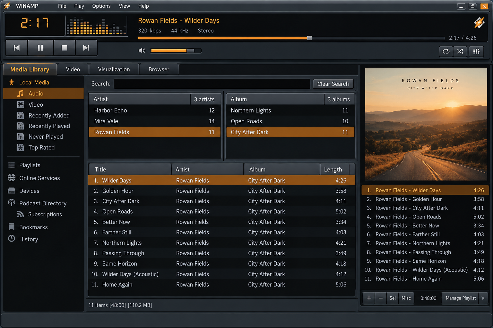
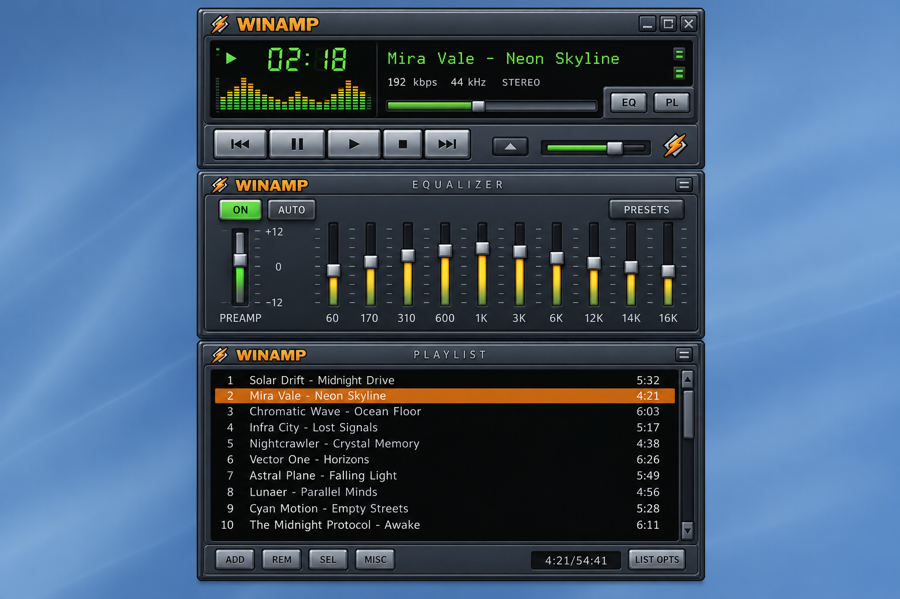
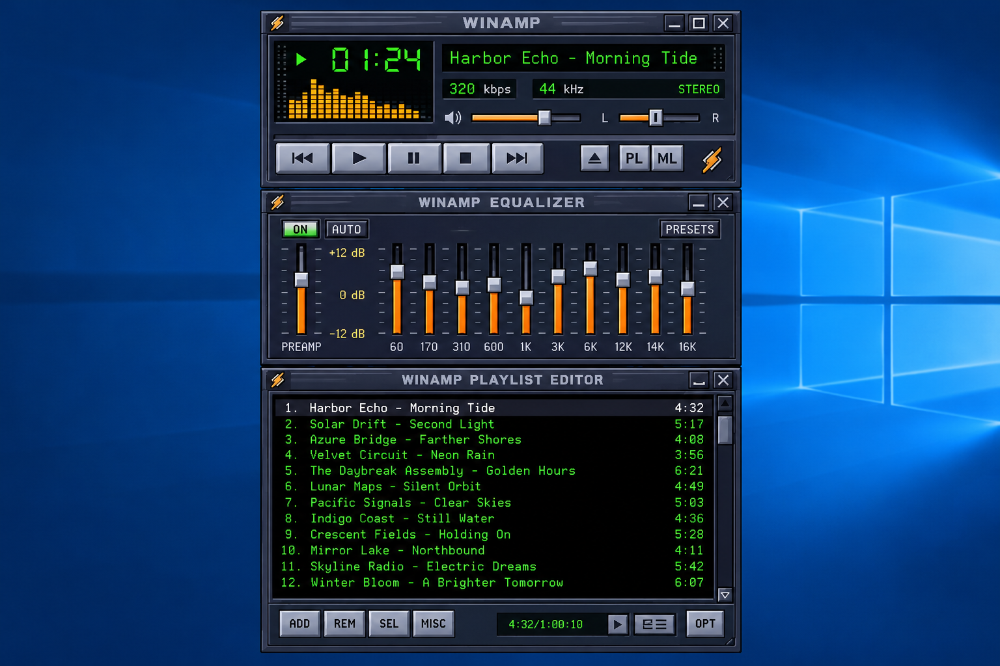

# Winamp Player - Classic Desktop Audio In The Browser

Nullsoft Winamp presents Winamp Player, a TypeScript recreation of the classic Winamp desktop experience. Winamp Player combines local audio playback, Winamp skins, playlists, an equalizer, and MilkDrop visualization support in a browser-based interface.

[](https://nullsoft-winamp.github.io/winamp-player/winamp-player)

## Read The Docs

Start with the [Winamp Player overview](docs/01_intro.md), then explore:

- [Keyboard shortcuts](docs/01_hotkeys.md)
- [Equalizer controls](docs/03_equalizer.md)
- [Playlist management](docs/04_playlist.md)
- [Winamp skins](docs/05_skins.md)
- [Project changes](CHANGELOG.md)

## About This Repository

Winamp Player is the main repository maintained by Nullsoft Winamp. It focuses on a compact Winamp web implementation rather than reproducing every component from the historical Winamp 5.666 or Winamp 5.9 distributions.



The selected code includes the classic player window, equalizer, playlist, skin resolution, media-session integration, and MilkDrop rendering. It does not include native C++, Flutter, mobile launch assets, Docker builds, MPRIS integration, EQF file creation, HLSL translation, or a standalone projectM frontend.

| Area | Implementation |
|---|---|
| Playback | [`AudioPlayer.ts`](src/AudioPlayer.ts), [`Player.ts`](src/Player.ts), and [`media.ts`](src/media.ts) |
| Desktop | [`Desktop.tsx`](src/Desktop.tsx) and [`WindowManager.tsx`](src/WindowManager.tsx) |
| Classic skins | [`ClassicSkinResolver.ts`](src/ClassicSkinResolver.ts) and [`SkinEngine.ts`](src/SkinEngine.ts) |
| Modern skins | [`ModernSkinResolver.ts`](src/ModernSkinResolver.ts), XML objects, and bitmap fonts |
| Equalizer | [`EqGraph.tsx`](src/EqGraph.tsx), [`EqVis.ts`](src/EqVis.ts), and equalizer controls |
| Playlists | Playlist menus, scrolling, resizing, shading, and playback actions |
| Visualizations | [`Visualizer.tsx`](src/Visualizer.tsx), [`milkdrop.ts`](src/milkdrop.ts), and Butterchurn integration |
| Media integration | Album art and browser Media Session support |

## Player Vocabulary

nullsoft winamp, classic winamp, winamp player, winamp desktop, winamp media player, winamp music visualizer, media-player, music-player, audio-player, mp3-player, milkdrop, music-visualizer, desktop-player, windows-audio

## Examples

The repository follows the minimal Webamp examples while combining their features into one application:

- A minimal Winamp online player rendered from [`index.html`](index.html).
- Multiple audio tracks managed through the Winamp playlist interface.
- Multiple Winamp skins resolved by classic and modern skin handlers.
- Configurable initial placement for Winamp desktop windows.
- A minimal MilkDrop visualization connected to the active audio stream.
- Multiple MilkDrop presets selected through the preset context menu.
- Lazy browser loading with TypeScript and Vite.

The application entry point is [`src/index.tsx`](src/index.tsx). The top-level interface is assembled in [`src/App.tsx`](src/App.tsx), while [`src/Webamp.tsx`](src/Webamp.tsx) coordinates the recognizable Winamp Player experience.

## Getting Started

Winamp Player uses pnpm, TypeScript, React, and Vite. Configuration is defined in [`package.json`](package.json), [`tsconfig.json`](tsconfig.json), and [`vite.config.ts`](vite.config.ts).

```bash
pnpm install
pnpm start
```

The development server supports live updates while editing the Nullsoft Winamp interface. The lockfile at [`pnpm-lock.yaml`](pnpm-lock.yaml) keeps dependency versions reproducible.

### How Can I Install Winamp On My Windows Computer?

Use the single Winamp Player badge above to obtain the repository package. Extract it into a local folder, open PowerShell in that folder, install Node.js and pnpm if they are not already available, and run `pnpm install` followed by `pnpm start`.

Open the local address displayed by Vite to use Winamp for Windows. This workflow supports modern Windows systems, including Winamp Windows 10 and Winamp Windows 11 environments. The current Nullsoft Winamp repository is a browser application, not a native Winamp 64 bit installer or an archived Winamp old version executable.

## Features

Winamp Player brings the most recognizable parts of classic Winamp into a maintainable TypeScript codebase:

- Local music playback through browser audio APIs.
- A familiar main window with volume, balance, time, bitrate, frequency, repeat, and shuffle controls.
- A visual equalizer for Winamp with automatic and enabled states.
- A resizable Winamp playlist with menus, scrolling, shading, and playback actions.
- Winamp classic skins loaded through bitmap, INI, image, cursor, and skin-model abstractions.
- Early Winamp modern support through XML objects, bitmap fonts, and a dedicated resolver.
- Winamp visualizations driven by FFT data and MilkDrop presets.
- Browser Media Session integration for system playback controls.
- Album-art presentation and contextual playback menus.
- Responsive desktop window management.



The Winamp media player keeps the modular character of the original application. Main-window styling lives in [`src/main-window.css`](src/main-window.css), equalizer styling in [`src/equalizer-window.css`](src/equalizer-window.css), playlist styling in [`src/playlist-window.css`](src/playlist-window.css), and visualization styling in [`src/milkdrop-window.css`](src/milkdrop-window.css).

### What Are Some Good Music Players For Windows 11?

Winamp Player is a strong option for users who want a lightweight, nostalgic interface instead of a large streaming client. It provides the familiar controls associated with a Winamp music player while using modern browser audio and media-session APIs.

The Nullsoft Winamp implementation is especially suitable when Winamp skins, a configurable Winamp playlist, and a Winamp MilkDrop visualizer matter more than account-based services. Because this Winamp for PC project runs through Vite, it can be tested on Windows 11 without relying on an unsupported historical installer.

## Development

The Winamp Player source is organized around small TypeScript and TSX components. Changes to the player can be previewed with live reloading.

```bash
pnpm start
```

Important implementation areas include:

- [`src/AudioPlayer.ts`](src/AudioPlayer.ts) for audio playback.
- [`src/MediaCenter.ts`](src/MediaCenter.ts) for media coordination.
- [`src/WindowManager.tsx`](src/WindowManager.tsx) for Winamp desktop windows.
- [`src/SkinEngine.ts`](src/SkinEngine.ts) for skin rendering.
- [`src/FFTNullsoft.ts`](src/FFTNullsoft.ts) for visualization audio data.
- [`src/webampWithButterchurn.ts`](src/webampWithButterchurn.ts) for MilkDrop integration.

Winamp Player deliberately uses TypeScript for its application logic and CSS for its interface. Native projectM libraries, SDL test interfaces, C++ API headers, HLSL parsers, DeaDBeeF plugins, and Flutter platform projects are outside the scope of this repository.

## Building

Create an optimized Winamp web build with the build task defined by [`package.json`](package.json).

```bash
pnpm build
```

The build combines the TypeScript player, classic Winamp interface, Winamp skins infrastructure, playlist controls, equalizer, and MilkDrop visualization code. Vite handles development and bundling without requiring the original Winamp desktop SDK.

## Testing

Run the configured Winamp Player test suite with:

```bash
pnpm test
```

The test configuration is stored in [`vitest.config.ts`](vitest.config.ts). The curated MilkDrop files under `presets` are intentionally small and target specific rendering behavior:

- [`000-empty.milk`](presets/000-empty.milk)
- [`001-line.milk`](presets/001-line.milk)
- [`100-square.milk`](presets/100-square.milk)
- [`300-beatdetect-bassmidtreb.milk`](presets/300-beatdetect-bassmidtreb.milk)
- [`Test_A.milk`](presets/Test_A.milk)

These presets help expose regressions in empty rendering, line drawing, per-frame equations, waveform behavior, and beat detection.

## Advanced Usage

Winamp Player can be configured through [`src/config.ts`](src/config.ts). The application supports initial media, skin selection, window behavior, visualization options, and other player state.

The layout is controlled by the Winamp desktop and window manager. Skin assets pass through specialized classic or modern resolvers before image, bitmap-font, INI, and XML resources are connected to interface objects.

The Winamp music visualizer consumes audio data through [`src/FFTNullsoft.ts`](src/FFTNullsoft.ts). Butterchurn then renders MilkDrop-style presets through [`src/milkdrop.ts`](src/milkdrop.ts) and [`src/webampWithButterchurn.ts`](src/webampWithButterchurn.ts).

### What Does Winamp Stand For?

Winamp is the product name of the media player originally created by Nullsoft. It is generally understood as a blend of “Windows” and “amplifier,” reflecting its origins as a compact Windows audio player, but it is a name rather than a formal acronym.

In this repository, Nullsoft Winamp identifies the organization and Winamp Player identifies the application. The implementation preserves the recognizable classic Winamp interaction model while rebuilding it with browser technologies.

## Performance Improvements

The compact component structure leaves several opportunities for continued work:

- Profile modern-skin parsing and initialization.
- Reduce unnecessary updates from audio time events.
- Move expensive color transformations toward GPU-backed rendering.
- Delay image and font processing until a skin asset is needed.
- Reduce the number of DOM elements used by bitmap fonts.
- Improve event-listener management for modern-skin objects.
- Draw complex visual effects with fewer rendering surfaces.

## Phases Of Initialization

### Asset Parse

Winamp Player begins with configuration and skin resources. Classic resources are interpreted through INI and bitmap helpers, while modern resources use XML objects and dedicated skin resolvers.

This phase can be asynchronous because images, fonts, archives, and visualization resources may require browser file or image operations.

### Object Initialization

The skin engine initializes player objects after required resources are available. Components resolve their images, fonts, menus, controls, and parent-child relationships before the windows become interactive.

### Player Initialization

The audio player, media center, playlist controls, equalizer state, browser media session, and visualization pipeline are connected. Historical Maki virtual-machine execution is not included in this curated Winamp Player file set.

### First Paint

The main Winamp desktop, player controls, playlist, equalizer, and active skin become visible. MilkDrop rendering begins when audio analysis data and a preset are available.

## Winamp Equalizer Presets

The Winamp Player interface includes a ten-band equalizer and visible spectrum feedback. The selected repository does not include the standalone Winamp EQF parser or creator, so `.eqf` and `.q1` serialization should not be presented as a supported API.

Equalizer behavior is implemented by [`src/EqGraph.tsx`](src/EqGraph.tsx), [`src/EqAuto.tsx`](src/EqAuto.tsx), [`src/EqOn.tsx`](src/EqOn.tsx), and [`src/EqToggleButton.tsx`](src/EqToggleButton.tsx). Additional behavior is documented in [Equalizer controls](docs/03_equalizer.md).

## Presets

MilkDrop presets describe a visualization using equations, waveform parameters, and per-frame behavior. Winamp Player ships only the five selected regression-oriented presets rather than a large preset collection.

The preset menu is implemented by [`src/PresetsContextMenu.tsx`](src/PresetsContextMenu.tsx). The active MilkDrop visualization is rendered inside the Winamp desktop and can react to frequency data, beat intensity, and waveform state.

### What Can I Use Instead Of Winamp On Linux?

Use this Winamp Player repository as a browser-based Winamp for Linux experience. Install its JavaScript dependencies, start the Vite development server, and open the local application in a modern Linux browser.

This approach retains classic Winamp skins, playlist controls, the equalizer, and MilkDrop visualization without requiring a native Windows compatibility layer. System-level integrations such as MPRIS are not included, so desktop media-key behavior depends on browser Media Session support.

## Known Bugs

- Modern Winamp skins are only partially implemented.
- Some complex skin layouts may scroll or position controls incorrectly.
- Transparent click-through behavior may vary between browsers.
- Large bitmap-font interfaces may create many DOM elements.
- Custom Winamp language pack handling is not included.
- Native Winamp addons and SHOUTcast DSP plugins cannot run in the browser.
- CD ripping, CD burning, and native Winamp video player codecs are outside the selected source.
- Browser security rules may prevent remote skins or audio files from loading without suitable cross-origin headers.

## Screenshots



The screenshots represented here should show the main Nullsoft Winamp window, the Winamp playlist, the equalizer, classic Winamp skins, and the active MilkDrop visualization without implying native features that are absent from Winamp Player.

## Help

Review the documentation before reporting a problem:

- Use [Introduction](docs/01_intro.md) for the application overview.
- Use [Hotkeys](docs/01_hotkeys.md) for keyboard behavior.
- Use [Equalizer](docs/03_equalizer.md) for audio controls.
- Use [Playlist](docs/04_playlist.md) for track management.
- Use [Skins](docs/05_skins.md) for classic and modern skin behavior.

When investigating a failure, include the browser, operating system, selected skin, audio format, active preset, and steps required to reproduce the issue.

## Contribute To Winamp Player

Contributions to Nullsoft Winamp should preserve the lightweight architecture and familiar Winamp Player behavior. Keep TypeScript changes focused, avoid mixing unrelated native stacks into the repository, and test the main window, playlist, equalizer, skin rendering, and MilkDrop visualization before submitting changes.

Formatting rules are defined by [`.editorconfig`](.editorconfig), [`.eslintrc.js`](.eslintrc.js), and [`.prettierignore`](.prettierignore).

## Thanks

Winamp Player builds on the ideas established by the original Nullsoft Winamp interface, Webamp’s browser reimplementation, Butterchurn’s MilkDrop rendering, projectM’s visualization research, modern-skin experiments, and long-running open-source music-player projects.

Thanks go to the developers, skin authors, preset creators, testers, archivists, and community members who preserved classic Winamp behavior and documented its file formats.

## License

The repository license is available in [`LICENSE`](LICENSE). Winamp names, interface concepts, skins, presets, and third-party assets may have separate ownership or licensing requirements. Review those terms before distributing a modified Nullsoft Winamp build or publishing Winamp Player assets.
